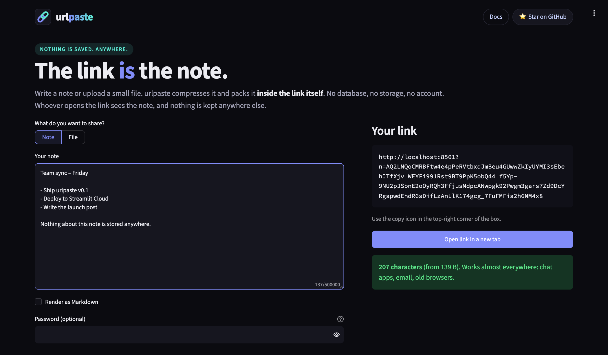
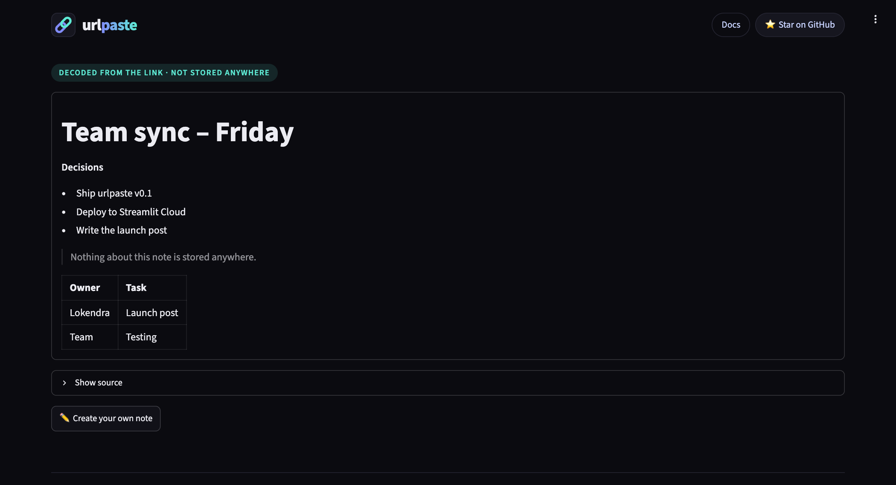
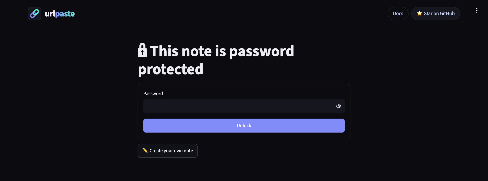
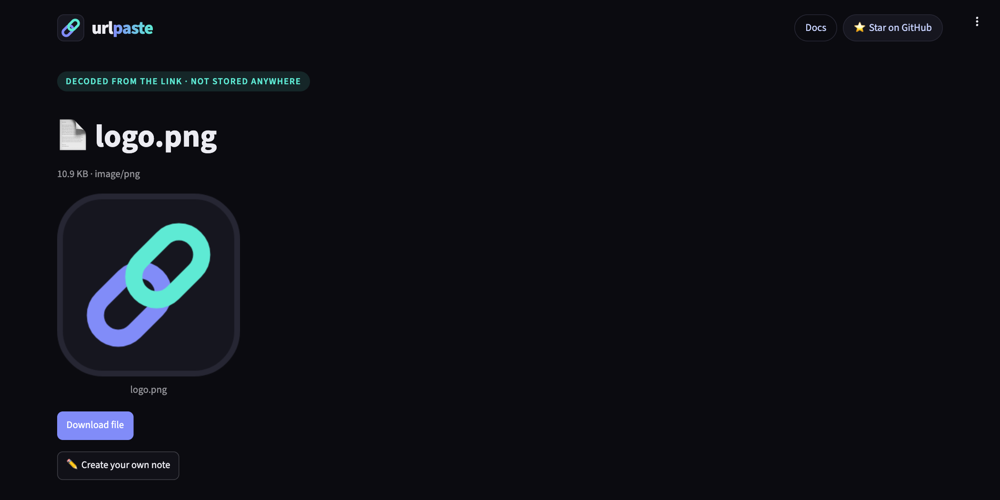
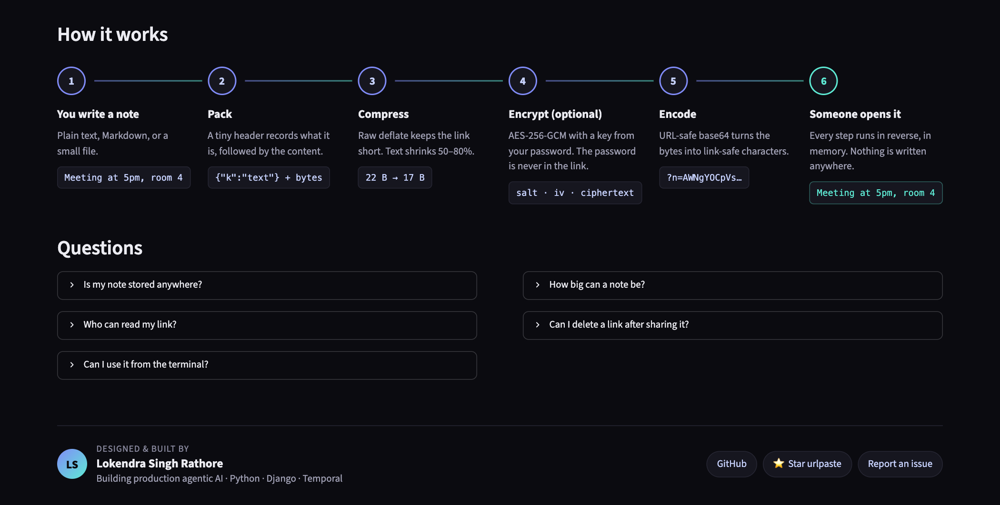
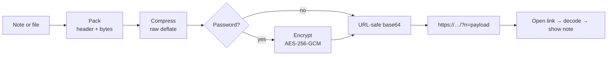

<p align="center">
  <picture>
    <source media="(prefers-color-scheme: dark)" srcset="assets/logo-wordmark-dark.png">
    
  </picture>
</p>

# urlpaste: share notes and files as a link, with nothing saved anywhere

> **The link is the note.** Write a note or upload a small file, and urlpaste packs the whole thing *inside the link*. No database, no storage, no account. Whoever opens the link sees the note, and nothing is kept anywhere else.

[](https://github.com/lokendra-builds/urlpaste/actions/workflows/ci.yml)
[](https://www.python.org/)
[](https://streamlit.io/)
[](LICENSE)

**Live demo:** https://urlpaste.streamlit.app/

<p align="center">
  
</p>

---

## What the app does

Normally, sharing a note means uploading it somewhere: a pastebin, a Google Doc, a chat app. That service keeps a copy, often forever.

urlpaste works differently. It **turns your note into the link itself**:

```
https://urlpaste.streamlit.app/?n=AWNgYOCpVspWslIqSa0oUar1SM3JyVdUCMnILFYoz8jPSVXIyy9JVcjJLEstVsjMUyjJAHHysvUA
                               └──────────────────── this part IS the note ────────────────────┘
```

1. You write a note (or upload a small file) and get a link.
2. You send the link to someone.
3. They open it, and the app decodes the note from the link and shows it.

There is no database and no file storage. The link is the only copy of your note.

## Features

| | |
|---|---|
| 🔗 **Nothing is saved** | No database, no storage, no account, no cookies. The link is the only copy. |
| 📝 **Notes, Markdown, files** | Plain text, rendered Markdown, or any small file (up to 1 MB) with a download button. |
| 🔒 **Password protection** | AES-256-GCM encryption with a key from your password (PBKDF2-SHA-256, 600,000 rounds). The password is never in the link. |
| 🗜️ **Short links** | Content is compressed before encoding. Normal text shrinks 50–80%. |
| 📏 **Honest size meter** | Tells you whether the link will survive chat apps, email, or a QR code. |
| 💻 **CLI included** | `urlpaste encode notes.md` prints a link, and `urlpaste decode <link>` opens one, straight from the terminal. |
| 🛡️ **Safe to open** | HTML in Markdown is escaped, tampered links are rejected, and "zip bomb" links are refused. |

## Screenshots

The screenshot at the top shows the create page. Here's the rest of the app:

<table>
  <tr>
    <td width="50%" valign="top">
      <b>Open a note</b><br>
      <sub>Markdown is rendered, including tables and quotes. Nothing is stored.</sub><br><br>
      
    </td>
    <td width="50%" valign="top">
      <b>Password-protected links</b><br>
      <sub>Encrypted notes ask for the password before anything is shown.</sub><br><br>
      
    </td>
  </tr>
  <tr>
    <td width="50%" valign="top">
      <b>Share small files</b><br>
      <sub>Images get a preview, and every file gets a download button.</sub><br><br>
      
    </td>
    <td width="50%" valign="top">
      <b>How it works</b><br>
      <sub>A step-by-step timeline and FAQ, right in the app.</sub><br><br>
      
    </td>
  </tr>
</table>

---

## Setup

**Requirements:** Python 3.10 or newer, and Git.

```bash
# 1. Clone the repo
git clone https://github.com/lokendra-builds/urlpaste.git
cd urlpaste

# 2. Create a virtual environment inside the project folder
python3 -m venv .venv
source .venv/bin/activate          # Windows: .venv\Scripts\activate

# 3. Install everything (Streamlit, cryptography, pytest, and the urlpaste package itself)
pip install -r requirements.txt
```

## Run the web app

```bash
streamlit run streamlit_app.py
```

Open **http://localhost:8501** in your browser.

- **Create:** type a note, and the link appears on the right. Click **Open link in a new tab** to see it decode.
- **Open:** any link with `?n=…` shows the note. Password links ask for the password first.

To use a different port: `streamlit run streamlit_app.py --server.port 8080`

## Use the CLI

Installing `requirements.txt` also installs the `urlpaste` command:

```bash
# Text from the terminal
echo "Meeting at 5pm, room 4" | urlpaste encode

# A Markdown file, rendered when opened
urlpaste encode notes.md --markdown

# Any small file (an image, PDF, or config)
urlpaste encode diagram.png

# Password protected (prompts for the password; never put it on the command line)
urlpaste encode secrets.txt --text --password

# Open a link: prints text, or saves a file with its original name
urlpaste decode "https://urlpaste.streamlit.app/?n=AW…"
urlpaste decode "https://urlpaste.streamlit.app/?n=AW…" -o copy.png
```

Run `urlpaste --help` or `urlpaste encode --help` for all options.

## Use it as a Python library

```python
from urlpaste import TextItem, FileItem, make_link, decode, payload_from_link

link = make_link(TextItem("hello", kind="markdown"), password="optional")
item = decode(payload_from_link(link), password="optional")
print(item.text)  # hello
```

---

## Configuration

### Streamlit settings: `.streamlit/config.toml`

```toml
[server]
maxUploadSize = 1              # MB. Files must fit inside a link, so keep this small.
enableXsrfProtection = true

[client]
toolbarMode = "minimal"        # hides the "Deploy" button and developer menu from visitors
showErrorDetails = false       # visitors never see stack traces

[browser]
gatherUsageStats = false       # no usage stats sent to Streamlit

[theme]
base = "dark"
primaryColor = "#818cf8"
backgroundColor = "#0b0b10"
secondaryBackgroundColor = "#16161f"
textColor = "#ececf2"
```

You can change the theme (switch `base` to `"light"`, or change the colors) or the port (`[server] port = 8080`) here. Full options are in the [Streamlit config docs](https://docs.streamlit.io/develop/api-reference/configuration/config.toml).

### Link base URL

- **Web app:** links automatically point to wherever the app is running (localhost, or your deployed URL). There's nothing to configure.
- **CLI:** links point to the public demo by default. If you deploy your own copy, pass your URL:

  ```bash
  urlpaste encode notes.txt --base-url https://your-app.streamlit.app/
  ```

  To change the default permanently, edit `DEFAULT_BASE_URL` in [urlpaste/codec.py](urlpaste/codec.py).

### Secrets and environment variables

None needed. urlpaste has no API keys, database, or `.env` file. (`.env` and `.streamlit/secrets.toml` are gitignored anyway, in case you add any.)

## Deploy your own (free)

1. Fork this repo on GitHub.
2. Go to [share.streamlit.io](https://share.streamlit.io) and sign in with GitHub.
3. Click **Create app**, pick your fork, branch `main`, and main file `streamlit_app.py`.
4. Optionally choose a custom subdomain, e.g. `your-name-urlpaste.streamlit.app`.
5. Click **Deploy**. Streamlit installs `requirements.txt` automatically.

---

## Run the tests

```bash
pytest -q
```

```
40 passed
```

There are three test suites:

| File | What it covers |
|---|---|
| `tests/test_codec.py` | Round-trips (Unicode, Hindi, emoji, binary), encryption, wrong password, tampered/truncated links, zip bombs, link parsing |
| `tests/test_cli.py` | encode/decode from stdin and files, password prompts, overwrite protection, size limits |
| `tests/test_app.py` | The real Streamlit app via `AppTest`: create a link, open it, unlock it, wrong password, broken link, HTML escaping |

CI runs all of them on Python 3.10, 3.12, and 3.13 for every push.

## How it works



| Step | Detail |
|---|---|
| Pack | `uint32 header length` + `JSON meta` (kind, file name, MIME type) + `content bytes` |
| Compress | Raw deflate (`zlib`, `wbits=-15`) |
| Encrypt | PBKDF2-SHA-256 (600k rounds, random 16-byte salt) → AES-256-GCM (random 12-byte IV) |
| Encode | 1 format byte (`1` = plain, `2` = encrypted) + body → base64url |
| Decode guard | Decompression stops at 20 MB, so a tiny malicious link can't exhaust memory |

## Project structure

```
urlpaste/
├── streamlit_app.py       # the web app (create + open links)
├── urlpaste/              # the Python package
│   ├── codec.py           # encode/decode: pack, compress, encrypt, base64url
│   ├── cli.py             # `urlpaste` command
│   └── limits.py          # link-length guidance
├── assets/                # logo (SVG source + PNG renders)
├── docs/                  # screenshots for this README
├── tests/                 # pytest: codec, CLI, and Streamlit app tests
├── .streamlit/config.toml # Streamlit settings
├── pyproject.toml         # package metadata + `urlpaste` CLI entry point
└── requirements.txt       # everything needed to run, test, and deploy
```

## Privacy, honestly

- **Nothing is stored.** There is no database or file storage. When a link is opened, the app decodes it in memory, shows it, and keeps nothing.
- **The link travels like any URL.** It's sent to the server that runs the app, and hosting providers may log visited URLs. Links also end up in browser history and chat logs. **Use a password for anything sensitive.** Encrypted links are unreadable without it.
- **You can't delete a shared link.** Whoever has the link has the content. That's the trade-off for storing nothing.

## Limits

| Link length | What to expect |
|---|---|
| < 2,000 chars | Works almost everywhere |
| ≤ ~2,900 | Still fits in a QR code |
| ≤ ~32,000 | Fine between browsers; many chat apps truncate |
| > ~2 MB | Browsers refuse it |

It's built for notes, snippets, and small files, not big uploads.

## Roadmap

- [ ] QR code for short links
- [ ] Syntax highlighting for code snippets
- [ ] Publish to PyPI (`pip install urlpaste`)
- [ ] "Burn after reading" hint (clearly labeled, since nothing can enforce it)

## Contributing

Issues and PRs are welcome. Add a test for any change, and run `pytest -q` before opening a PR.

## Author

**Lokendra Singh Rathore**, building production agentic AI systems with Python, Django, Temporal, and LangGraph.

- GitHub: [@lokendra-builds](https://github.com/lokendra-builds)

If urlpaste is useful to you, a ⭐ on the repo helps others find it.

## License

[MIT](LICENSE) © Lokendra Singh Rathore
